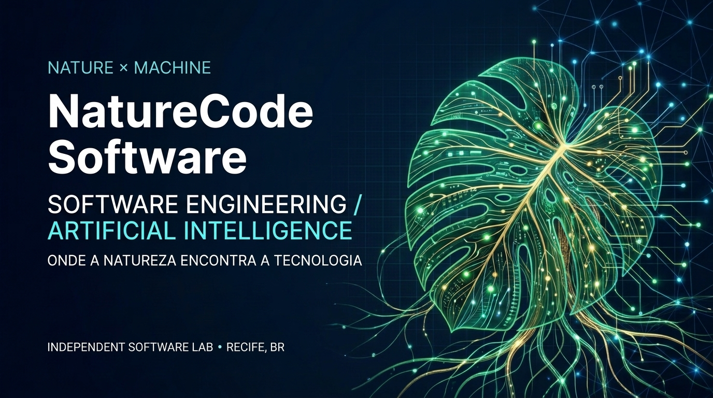

 

### Tecnologia que transforma complexidade em produtos.

**Engenharia de software · Inteligência artificial · Automação · SaaS**

---

## Olá, eu sou André Oliveira.

Sou responsável pela **NatureCode**, uma iniciativa de engenharia de software focada em criar produtos digitais úteis, escaláveis e sustentáveis. Trabalho na interseção entre sistemas de gestão, inteligência artificial e automação — da concepção do produto à sua evolução contínua.

> **Nossa filosofia:** entender problemas reais, estudar soluções existentes e construir tecnologia própria com engenharia, segurança e foco em resultados.

## Ecossistema de produtos

<table>
<tr>
<td width="50%" valign="top">

### ⚡ FABRYON
**Software Factory · AI Orchestration**

Fábrica automatizada de software e micro-SaaS, com agentes especializados, fluxos de construção e validação de produtos.

Foco: automação do ciclo de desenvolvimento.

</td>
<td width="50%" valign="top">

### 🐉 JINLONG
**ERP · Retail Technology**

Plataforma de gestão empresarial com foco em operações comerciais, PDV, estoque, financeiro e evolução de processos.

Foco: gestão operacional integrada.

</td>
</tr>
<tr>
<td width="50%" valign="top">

### 🛒 VENDDI
**Commerce · SaaS**

Solução de gestão comercial voltada a lojistas brasileiros, conectando vendas, produtos e operação cotidiana.

Foco: simplicidade para o varejo.

</td>
<td width="50%" valign="top">

### 🌎 GEO PORTAL
**Geospatial Intelligence · Data**

Plataforma de análise e integração de dados territoriais para apoiar visualização e decisões orientadas por evidências.

Foco: informação geoespacial.

</td>
</tr>
</table>

Os produtos possuem estágios distintos de desenvolvimento. Repositórios privados e funcionalidades em evolução não representam demonstrações públicas ou disponibilidade comercial.

## Áreas de atuação

| Engenharia | Inteligência | Produto |
| :--- | :--- | :--- |
| Arquitetura de software | Agentes de IA | Descoberta e validação |
| Sistemas web e APIs | Automação de processos | Micro-SaaS e ERP |
| Bancos de dados e integrações | Orquestração de modelos | UX e melhoria contínua |
| Qualidade e segurança | Dados e observabilidade | Operações comerciais |

## Princípios de engenharia

- **Segurança desde o início** — acesso mínimo, auditoria e proteção de dados.
- **Software verificável** — testes, critérios de aceite e entregas incrementais.
- **Automação com supervisão** — agentes auxiliam; decisões críticas exigem validação.
- **Sustentabilidade técnica** — simplicidade, manutenção e controle de custos.

---

### Vamos construir algo relevante?

**NatureCode · Recife, Brasil**

© NatureCode — Software Engineering & AI

